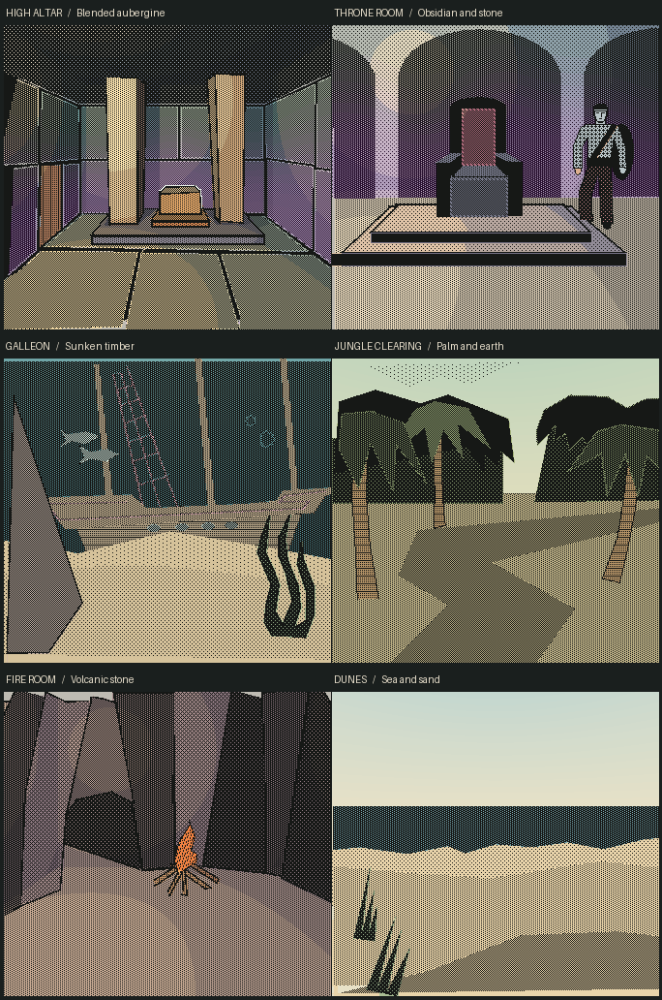

# Lit colour

Lit colour follows the shapes in the Macintosh drawings. The ink marks at the doorway retain their original pixel positions on the 338 × 314 canvas. At the High Altar, a world-fixed lamp lights the pillars and casts their shadows, while a heather tint crosses the joint between the lower wall and the upper slate. Outdoors, the wash follows the sky and water around a turn. The colours and lighting are interpretations for this edition.

Use **Classic B/W** or **L** to compare the live scene with the original disk view. The same control returns to Lit colour or Refreshed 1-bit, whichever you last selected. The picture choice is stored separately from the adventure save, for the browser's launch address. The disk cabinet retains its source plates.

## How the paint stays on the drawing

- Each of the 200 rooms has a theme and material assignments for its QuickDraw commands. The 14 themes share material roles such as wood, water, gold and foliage. An artist can give an individual object a different role without changing its shape. [Indoor survey](interiors.tsv) · [Outdoor survey](outdoors.tsv)
- The material maps include the full drawings, the clean backgrounds behind separated scenery, and the foreground pieces themselves. Visible and turned-away parts of the world use the same room palette. The outdoor survey specifies the materials above the horizon, on the ridge and below it.
- Each visible native object and inhabitant has a registered material map. The in-world sprite and its Pack icon use the original ink and alpha mask. Dark Castle visitors keep their native animation frames. Visited rooms on the Travel chart pick up their region's colour. [Sprite survey](sprites.tsv)
- The software shader uses existing ray hits and face normals on the CPU. The artwork is sampled without image smoothing. It works offline in the normal launcher. [Live shader](../../game/colour.js) · [Earlier single-view High Altar study](../refresh/studies/high-altar-colour-lab.html)

## Rebuild and verification

Run `python art/build_colour.py` to regenerate the packed PNGs and their index. It requires Python, NumPy and Pillow. The lower five bits of each painted texel identify its material. Bit 5 protects contour ink. Bit 6 identifies narrow unprinted paper margins. The source PNGs, room scripts, sprite frame sizes and walking rigs are independent of these maps.

With a muted, isolated test server, run `python art/verify_colour.py http://127.0.0.1:<port>/`. Start the bundled Java with `-Duser.home=<throwaway-directory> -jar engine/adventure.jar --test <port>` and confirm a test save there first. The audit checks room poses, doorway ink, comparison round trips, native icons and sprite frames. Add `--out <directory> --all-sheets` to write all 200 full-resolution comparison sheets. The original two-colour rig checks are still available through `art/review_rigs.py`.
